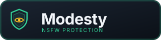

<p align="center"></p>

# Modesty — NSFW protection toolkit

Modesty is a privacy-first NSFW content scanner. It rates websites, images,
video, audio and subtitle text on a **1–10** scale, runs locally by default,
and never uploads anything unless you explicitly ask it to. The code and the
free database are open source (MIT). Contributors get credits and use the
shared data for free; paid tiers are for people who would rather not
contribute. A separate device app funds the work.

This is the **meta repository**: the map and the big picture. Each component
lives in its own public repository below.

## What the rating scale means

| Rating | Meaning |
|---|---|
| 1 | no unsafe signal detected by a successful scan (not a "safe" guarantee) |
| 2 | synthetic/unassessed — a render or a drawing; we do not rate it |
| 5 | people present (women/girls) |
| 6 | romance — clothed, affectionate |
| 7 | revealing, not fully explicit |
| 8 | strongly suggestive (optional band, off by default) |
| 10 | explicit adult content |

An unavailable scan is never reported as 1. When the models or decoder are
missing the result is explicitly **not assessed** (`rating: null`).

## Public repositories (FOSS, MIT unless noted)

| Repository | What it is |
|---|---|
| [modesty-lib](https://github.com/sniffis-commits/modesty-lib) | Core scanning library, Python + Rust. Images/websites/video/audio. |
| [modesty-cli](https://github.com/sniffis-commits/modesty-cli) | `modesty-nsfw-scan` / `nsfw-scan` command-line scanner, plus Rust CLI and Native Messaging daemon. |
| [modesty-gui](https://github.com/sniffis-commits/modesty-gui) | Cross-platform desktop GUI (Tauri). |
| [modesty-webservice](https://github.com/sniffis-commits/modesty-webservice) | HTTP API service with the open `/v1/hash` and `/v1/sample` protocol. |
| [modesty-db](https://github.com/sniffis-commits/modesty-db) | The free domain database (`nsfw.sqlite`) importer and weekly release. |
| [modesty-extensions](https://github.com/sniffis-commits/modesty-extensions) | Browser extensions (offline/self-hosted mode is FOSS). |
| [modesty-models](https://github.com/sniffis-commits/modesty-models) | ONNX model weights (Apache-2.0 / CC), downloaded on first use. |

**Contribute and it is free.** Submitting a hash earns credits (1 hash = +10);
reading/downloading a hash costs 1 credit. The paid tiers are for people who
do not contribute and want unlimited reads instead. That is the funding model:
the data and code stay FOSS, contributors get free access, and non-contributors
pay for convenience.

A separate Android device app and the hosted infrastructure are developed
privately and are **not** part of these repositories. Only their interface
contracts are described here — no implementation details.

## How the pieces fit together

```
   modesty-lib  (Python + Rust core, ONNX models from modesty-models)
        |
        +---> modesty-cli      (local scans from a terminal)
        +---> modesty-gui      (desktop app, local scans)
        +---> modesty-webservice (optional hosted /v1 API, backed by modesty-db)
        +---> modesty-extensions (browser images -> your own or hosted /scan)
```

- **Local by default.** The library and CLI scan files on your machine. The
  models are downloaded once from `modesty-models` and cached; nothing else
  leaves the device.
- **Optional hosted scan.** The CLI/GUI can upload a copy of a file to a
  webservice for an independent second opinion. This is opt-in and uploads
  the media itself, not just a hash.
- **The free database.** `modesty-db` publishes weekly `nsfw.sqlite` releases
  containing pre-scored domains and, for operators, media hashes/results.

## Quick start

```bash
# library
pip install modesty_nsfw_scanner
python -c "from nsfw_scanner import scan; print(scan('photo.jpg', details=True))"

# CLI
pip install modesty_nsfw_cli
nsfw-scan photo.jpg --details
nsfw-scan clip.mp4 --skip-file --details       # needs ffmpeg + ffprobe
```

See each repository's README for a full "what this is / how to" guide.

## Data, privacy and licences

- Code is MIT. Model weights and blocklist data carry their own licences —
  see the site's licence table: https://modesty.cia.org.il/?p=licenses
- The webservice (`modesty-webservice`) accepts multipart uploads at `POST /scan`
  and `POST /v1/sample`. It scans the bytes, deletes the temporary file, and
  keeps only the SHA-256, rating and scan metadata. **The website's own API
  takes only a URL or a hash — never a file.** Self-host the webservice if that
  retention does not suit you.
- No telemetry. No network calls in the local scanning path.

Website: https://modesty.cia.org.il
